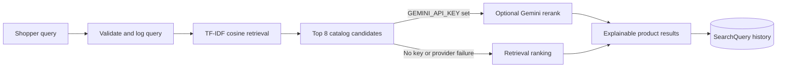

# Semantic Catalog

Semantic Catalog is a recruiter-ready product-search demo for Northwind Gadgets, a fictional shop. Enter an imperfect, natural-language request and a small, inspectable PHP retrieval pipeline ranks catalog products, surfaces the terms that matched, and logs the query and latency. An optional Gemini integration can rerank only the eight products already retrieved; without a Gemini API key, search runs entirely on TF-IDF.

## In 60 seconds

- **Retrieval:** pure-PHP TF-IDF vectors and cosine similarity over each product's name, description, and tags.
- **Explainability:** each result includes its similarity score and the query terms found in that product's text.
- **Optional AI:** Gemini can reorder the top eight candidates; it cannot invent products or expand the retrieval set.
- **Graceful fallback:** missing keys select retrieval-only mode. Provider errors and timeouts preserve the TF-IDF results.
- **Demo data:** 24 fictional products across cables, fans, lamps, and bags.



## Run locally

Requirements: PHP 8.3+, Composer, Node.js 22+, and npm. SQLite is used by default; no Redis, search service, or paid product API is required.

```bash
composer setup
php artisan db:seed
```

In one terminal, start Laravel:

```bash
php artisan serve
```

In another terminal, start Vite:

```bash
npm run dev
```

Open <http://localhost:8000>. The seeded Northwind Gadgets catalog is the demo fixture; it has no sign-in or demo credentials. Search works immediately without an API key and reports `TF-IDF` as its ranking mode.

### Optional Gemini reranking

Add a Gemini API key to `.env` to enable reranking of the eight TF-IDF candidates:

```dotenv
GEMINI_API_KEY=your-key
# GEMINI_MODEL=gemini-2.5-flash
```

The integration has a 12-second request timeout and a 3-second connection timeout. Invalid responses, exceptions, and timeouts fall back to the already-computed TF-IDF ordering. Keep the key server-side; it is never sent to the browser.

## How search works

`TfIdfSearchService` builds term-frequency vectors from `name + description + tags`, computes inverse document frequency from the current catalog, and sorts positive cosine similarities. It returns at most eight results, including their SKU, score, and matched query terms. Common query filler words are ignored, so phrases such as “cable that won't tangle” reduce to useful search terms.

`CatalogSearchService` optionally passes that bounded candidate list through the `App\Services\Llm\LlmClient` interface. The Gemini adapter may return SKU order only; unknown SKUs are discarded and omitted candidates retain their retrieval position. If Gemini is not configured, the retrieval-only implementation is used. If the call fails, ranking mode stays `TF-IDF` and the user still receives results.

`POST /api/search` accepts `{ "q": "quiet fan for studio" }`. It returns `results`, `mode`, and `latency_ms`; empty or invalid queries receive a JSON `422`. Each successful request is stored in `search_queries` with its query, ordered result SKUs, and measured latency.

## Tests

Run the Laravel/Pest suite:

```bash
php artisan test
```

The suite seeds the fictional catalog and binds `Tests\Support\FakeLlmClient` to `LlmClient`, so tests never call a real model. The fake keeps retrieval order for ordinary queries and swaps the first two candidates for a gift query. Feature and unit tests prove that:

- “quiet fan” ranks a fan first and reports matched terms;
- a gift query returns relevant catalog results and the fake rerank is applied;
- a messy anti-tangle phrase finds cable products;
- empty input returns `422`;
- TF-IDF returns no zero-score matches and never more than eight results; and
- a simulated LLM outage falls back to retrieval without a `500`.

Frontend checks and a production asset build are available through:

```bash
npm run check
npm run types:check
npm run build
```

## Stack

- Laravel 13 and PHP 8.3+
- Vue 3 with TypeScript and Inertia
- Tailwind CSS 4
- SQLite by default
- Pest for feature and unit tests

## Project map

```text
app/Services/Catalog/   TF-IDF retrieval and search orchestration
app/Services/Llm/       LlmClient interface, Gemini, retrieval-only adapter
app/Http/Controllers/   JSON search endpoint
app/Models/             CatalogItem and SearchQuery
database/seeders/       24 Northwind Gadgets demo products
resources/js/pages/     Vue catalog search experience
tests/                  AI behavior, API, and retrieval coverage
```
